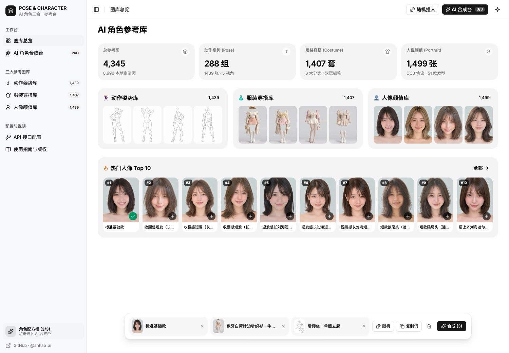
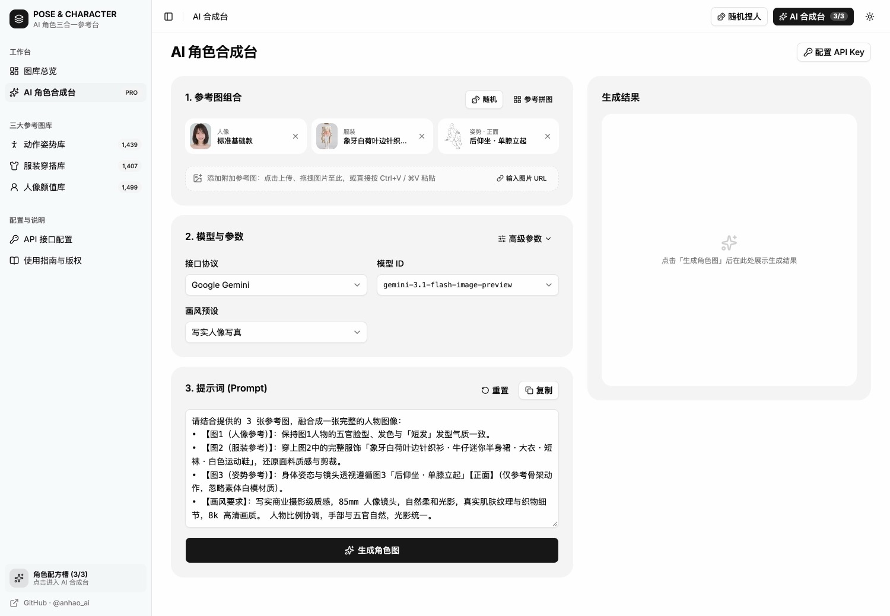
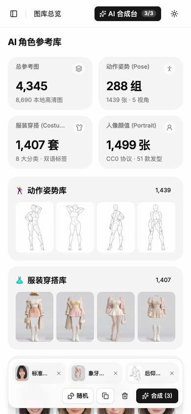

# AI 角色参考与合成工作台 · 中文版（3合1）

> **姿势库（1,439 张） + 服装库（1,407 套） + 人像库（1,499 位） = 4,345 条全中文参考数据 / 8,690 张本地高清图**，集成 **5 大 AI 图像协议直连工作台** 与 **原生 ComfyUI 自定义节点插件（`custom_nodes`）**。





<details><summary>手机端预览</summary>



</details>

**在线演示：** <https://ai-pose-gallery.anhao.app/>
**原始站点：**
- 姿势库：<https://ai-pose-gallery.pages.dev/>
- 服装库：<https://ai-costume-gallery.pages.dev/>
- 人像库：<https://ai-portrait-gallery.pages.dev/>

**原作者：** ギア（@giaaibusi）
**中文版维护：** Anhao · [X @anhao_ai](https://x.com/anhao_ai)
**GitHub：** <https://github.com/anhao/ai-pose-gallery-zh>

---

## 这是什么

原站是ギア（@giaaibusi）发布的三大 AI 绘画参考图库（姿势、服装、人像），元数据全部为日文，且分散在三个独立站点。本仓库（v2.0）完成了**三站合一、全量中文化、AI 角色合成工作台与 ComfyUI 原生插件升级**：

1. **三库全量本地镜像（8,690 张图）** —— 完整收录姿势库（2,878 张）、服装库（2,814 张）、人像库（2,998 张，全尺寸 `1600×2000` 高清 WebP）的全部缩略图与高清原图，支持纯离线浏览与静态托管。
2. **100% 纯净中文元数据（零日文残留）** —— 动作体系、姿势分类、服装款式、穿搭标签、人像分区、发长与 51 种细分发型全部译为地道中文，自动组装的生图提示词纯净无日文干扰。
3. **三合一 AI 角色合成工作台（Web Studio）** —— 基于 **React 19 + Tailwind CSS 4 + TypeScript 7 + shadcn/ui + TanStack Router** 构建的响应式多页面应用（兼容 PC / 平板 / 手机）：
   - 从三大图库任意挑选 **人像 + 服装 + 姿势** 组合配方，或一键随机捏人；
   - 支持拖拽、剪贴板粘贴（`Cmd+V` / `Ctrl+V`）或 URL 添加多张自定义附加参考图；
   - 内置 **5 大 AI 图像协议直连**（Google Gemini、OpenAI GPT Image、阿里云百炼 Qwen、字节火山方舟 Doubao、**本地 ComfyUI**），生成记录通过 **IndexedDB** 本地持久化保存。
4. **原生 ComfyUI 自定义节点插件（`custom_nodes`）** —— 本仓库同时是一个即插即用的 ComfyUI 插件！直接 `git clone` 到 `ComfyUI/custom_nodes/` 即可在 ComfyUI 画布内使用 **姿势 / 服装 / 人像 / 三合一角色配方** 4 个自定义节点与内置的 **4,345 张中文可视化弹窗选图器**。

---

## 核心功能

### 1. 三大参考图库（姿势 / 服装 / 人像）
- **姿势参考库（`/poses`）**：4 大体系（全身单人・标准系 / 全身单人・性感系 / 上半身单人 / 双人缠绵）、26 个动作分类、288 组姿势、5 种视角（正面 / 斜前 / 侧面 / 背面 / 俯视），支持**按姿势分组 / 逐张浏览**双模式及卡片内多角度切换。
- **服装参考库（`/costumes`）**：8 大穿搭分类（春季 / 夏季 / 秋季 / 冬季 / 内衣・睡衣 / 性感穿搭 / 泳装・度假 / 派对・礼服）、86 个中文细节标签与英文 Prompt 关键词。
- **人像参考库（`/portraits`）**：2 大分区（正脸参考 893 / 造型氛围 606）、4 种发长（短发 / 中发 / 中长发 / 长发）、51 种细分发型，支持**精选题集**与**热门榜单**一键筛选。
- **统一交互体验**：中文关键词实时检索、灯箱高清原图预览与下载、一键「加入合成配方」。

### 2. AI 角色合成台（`/studio`）
- **3+N 参考图组合**：3 个核心槽位（人像 / 服装 / 姿势）+ 任意张自定义附加参考图（点击上传、拖拽文件、剪贴板粘贴、填写图片 URL）。
- **参考拼图预览与导出**：弹窗查看三合一高清参考拼图（`1800×1200` Canvas 实时合成），支持一键下载拼图 PNG。
- **12 种画风预设 & 纯中文结构化提示词**：内置「无预设（跟随参考图）」、写实人像写真、日韩杂志画报、复古胶片写真、2.5D 游戏原画立绘、日系二次元插画、新海诚感动画电影、日式黑白漫画网点、3D 次世代角色渲染、3D 潮玩手办质感、赛博朋克霓虹、角色设定集立绘（纯白底）共 12 种画风，根据已选素材自动组装提示词。
- **5 大 AI 图像协议与高级参数**：
  - **Google Gemini**：`gemini-3.1-flash-image-preview`、`gemini-3-pro-image-preview`、`gemini-2.5-flash-image`（支持宽高比 `aspectRatio`、分辨率 `1K/2K/4K`）
  - **OpenAI GPT Image**：`gpt-image-2.5`、`gpt-image-2`、`gpt-image-1.5`、`gpt-image-1`（支持 `/v1/images/edits` JSON URL 直传 / Multipart 上传、尺寸、质量、背景透明度）
  - **阿里云百炼 Qwen**：`qwen-image-3.0-pro`、`qwen-image-2.1-pro`、`qwen-image-2.0-pro`、`qwen-image-edit-plus`（支持 `multimodal-generation` 多图参考输入、智能改写 `prompt_extend`、水印开关）
  - **字节火山方舟 Doubao**：`doubao-seedream-5-0`、`doubao-seedream-4-5-251128`、`doubao-seedream-4-0-250828`、`doubao-seededit-3-0-i2i-250628`（支持多图融合 `image: [...]`、2K/4K 分辨率）
  - **本地 ComfyUI 工作流引擎**：支持自动将三合一拼图及单张人像/服装/姿势图上传至本地 ComfyUI（`/upload/image`），注入自定义 API 工作流占位符或自动识别节点提交 `/prompt` 队列并轮询取回成品图；支持导入/导出通用 `.api.json` 工作流模板。
- **跨页面后台生图 & IndexedDB 历史记录**：切换页面不会中断正在进行的生图请求；生成结果自动存入浏览器 IndexedDB（避免 `localStorage` 容量限制），支持复用提示词与原图下载。

> 本地 ComfyUI 三图合成（Qwen Image Edit 2509）的模型清单、工作流说明和本地运行方法见 [docs/comfyui-local.md](docs/comfyui-local.md)。

### 3. ComfyUI 原生自定义节点插件（`comfyui_plugin/`）
将本仓库克隆到 `ComfyUI/custom_nodes/ai-pose-gallery-zh` 后，ComfyUI 画布右键菜单 **「AI角色三合一参考图集」** 下自动提供 4 个节点：
- **AI 姿势参考图 (`PoseGalleryNode`)**：输出 `姿势图 (IMAGE)`、`图片ID`、`姿势提示词`
- **AI 服装参考图 (`CostumeGalleryNode`)**：输出 `服装图 (IMAGE)`、`图片ID`、`中文服装描述`、`英文服装Prompt`
- **AI 人像参考图 (`PortraitGalleryNode`)**：输出 `人像图 (IMAGE)`、`图片ID`、`人像发型描述`
- **AI 角色三合一合成配方 (`CharacterRecipeNode`)**：单节点同时输出 `人像图`、`服装图`、`姿势图`、`三合一拼图` 以及自动组装的 `中文合成Prompt` 与 `英文合成Prompt`，并内置 **4,345 张中文可视化弹窗选图器**与节点内实时缩略图预览。

---

## 数据规模

| 图库 | 分类 / 体系划分 | 记录数 | 本地图片文件数 |
| --- | --- | ---: | ---: |
| **姿势库（Pose）** | 全身标准 (365) · 全身性感 (399) · 上半身 (400) · 双人缠绵 (275) | 1,439 | 2,878 张（缩略图 `.jpg` + 原图 `.png`） |
| **服装库（Costume）** | 春季 (215) · 夏季 (254) · 秋季 (244) · 冬季 (253) · 内衣睡衣 (199) · 性感 (140) · 泳装 (54) · 礼服 (48) | 1,407 | 2,814 张（缩略图 `.webp` + 原图 `.webp`） |
| **人像库（Portrait）** | 正脸参考 (893) · 造型氛围 (606) / 短发 (727) · 中发 (376) · 中长发 (260) · 长发 (136) | 1,499 | 2,998 张（缩略图 `.webp` + `1600×2000` 原图 `.webp`） |
| **合计** | **3 大图库全中文索引** | **4,345** | **8,690 张** |

---

## 在 ComfyUI 中使用（双模式支持）

### 模式 A：作为 ComfyUI 原生插件安装（在 ComfyUI 画布内选图）

无需安装额外 Python 依赖（直接复用 ComfyUI 自带的 `torch`、`numpy`、`Pillow`、`aiohttp`）：

```bash
cd /path/to/ComfyUI/custom_nodes
git clone --depth 1 https://github.com/anhao/ai-pose-gallery-zh.git
```

重启 ComfyUI 后：
1. 在画布空白处右键 → **新建节点** → **AI角色三合一参考图集**；
2. 选择 **「AI 角色三合一合成配方 (3-in-1 Recipe)」** 或单个姿势 / 服装 / 人像节点；
3. 点击节点上的 **「🎨 打开三合一选图器 (4,345张)」** 按钮（或直接点击节点上的缩略图），即可在弹窗中按分类、视角、发长筛选或中文搜索，一键填入节点并输出 `IMAGE` 张量与中英文 Prompt。

### 模式 B：从 Web 合成台直连本地 ComfyUI API

如果您使用线上网页端（或本地 `pnpm dev`）选图，希望直接调用本机 ComfyUI 生图：
1. 启动本地 ComfyUI 时开启跨域参数：
   ```bash
   python main.py --enable-cors-header "*"
   ```
2. 打开本工作台 **「接口配置」** 页面 → 切换到 **「本地 ComfyUI」** → 点击「检测连接」（默认 `http://127.0.0.1:8188`）；
3. 可直接导入您在 ComfyUI 中通过 `工作流 -> 导出 (API)` 保存的 `.json` 文件（支持 `{{prompt}}`、`{{seed}}`、`{{width}}`、`{{height}}`、`{{composite_image}}`、`{{portrait_image}}`、`{{costume_image}}`、`{{pose_image}}` 占位符，或由系统自动匹配 `CLIPTextEncode` / `KSampler` / `LoadImage` 节点），也可在 **「合成台」** 一键导出内置通用工作流模板。

---

## 技术栈与目录结构

- **前端框架**：React 19.3 + TypeScript 7.0 + Vite 8 (Rolldown)
- **路由与状态**：TanStack Router + TanStack Query + IndexedDB 本地存储
- **样式与组件**：Tailwind CSS 4.3 + shadcn/ui (Radix UI) + Lucide Icons
- **ComfyUI 插件**：Python (`aiohttp` + `Pillow` + `torch`) + LiteGraph Frontend Extension
- **代码质量**：Oxlint + Oxfmt

```text
.
├── __init__.py             # ComfyUI 自定义节点插件根入口 (NODE_CLASS_MAPPINGS / WEB_DIRECTORY)
├── comfyui_plugin/         # ComfyUI 原生插件模块
│   ├── nodes.py            # 姿势 / 服装 / 人像 / 三合一角色配方 4 个 ComfyUI 节点实现
│   ├── routes.py           # ComfyUI PromptServer 本地目录与图片静态服务路由
│   └── web/                # ComfyUI 画布节点缩略图预览与 4,345 张可视化弹窗选图器 (extension.js / style.css)
├── src/
│   ├── components/         # 通用组件、AppLayout 响应式导航、GalleryLightbox 灯箱、RecipeDock
│   ├── routes/             # 页面路由：概览(index)、姿势(poses)、服装(costumes)、人像(portraits)、合成台(studio)、配置(settings)、指南(guide)
│   ├── services/           # 5 大 AI 图像协议客户端 (aiGenerator.ts) 与 Canvas 拼图合成 (canvasComposer.ts)
│   ├── store/              # 全局配方、生图状态与 IndexedDB 历史管理 (studioStore.tsx)
│   ├── lib/                # 数据加载器 (dataLoader.ts) 与 IndexedDB 工具 (idbStorage.ts)
│   └── types/              # 三库数据结构与 5 大 AI 协议类型定义 (gallery.ts)
├── functions/api/proxy.ts  # Cloudflare Pages Functions / Workers 同源 CORS 代理 (/api/proxy)
├── worker.ts               # Cloudflare Workers 入口（静态资源 ASSETS + /api/proxy 路由）
├── wrangler.jsonc          # Cloudflare Workers 配置文件
├── data/
│   ├── pose.json / pose-zh.json                 # 姿势库原始数据 & 中文数据（1,439 条）
│   ├── costume.json / costume-zh.json           # 服装库原始数据 & 中文数据（1,407 条）
│   ├── portrait.json / portrait-zh.json         # 人像库原始数据 & 中文数据（1,499 条）
│   ├── meta-zh.json / *-meta-zh.json            # 三库中文体系分类元数据与热门榜单
│   └── translations.csv                         # 日⇄中翻译对照表
├── thumbs/                 # 缩略图目录（姿势根目录 + costume/ + portrait/）
├── img/                    # 高清原图目录（姿势根目录 + costume/ + portrait/）
├── scripts/
│   ├── download.py         # 三站并发下载器（断点续传 / 自动重试）
│   ├── i18n.py             # 日译中词典与人像发型/服装标签映射
│   ├── apply_translation.py# 生成三库 *-zh.json 纯中文数据与检索索引
│   ├── verify.py           # 校验本地图片完整性（存在性 / 大小 / 文件头）
│   └── build.sh            # 构建 Cloudflare 发布目录 dist/
├── skills/                 # Claude Code / Agent 姿势检索技能包
└── README.md
```

---

## 本地开发与构建

需要 **Node.js 20+** 与 **pnpm**：

```bash
# 1. 安装依赖
pnpm install

# 2. 启动本地开发服务器（默认 http://localhost:5173）
pnpm dev

# 3. 类型检查 + 生产构建 + 代码规范检查
pnpm build && pnpm lint
```

### 数据与图片维护脚本（Python 3）

```bash
# 拉取/补全三站图片（已存在的文件自动跳过，支持断点续传）
python3 scripts/download.py
WORKERS=64 python3 scripts/download.py   # 调整并发线程数

# 修改 scripts/i18n.py 词典后，重新生成三库中文 JSON
python3 scripts/apply_translation.py

# 校验全部图片文件是否完整
python3 scripts/verify.py
```

---

## 部署到 Cloudflare（Workers / Pages）

本项目自带 [wrangler.jsonc](wrangler.jsonc) 与 [worker.ts](worker.ts)，同时支持 **Cloudflare Workers（含静态 Assets + `/api/proxy` 同源代理）** 与 **Cloudflare Pages** 部署。仓库总体积约 `1.1 GB`、总文件数约 `8,735` 个、单文件全部 `< 2 MB`，完全符合 Cloudflare 免费版限制（单文件 ≤ 25 MiB，文件数 ≤ 20,000）。

### 方式一：Cloudflare Workers 自动/命令行部署（推荐，内置 `/api/proxy` 解决千问/豆包跨域）

```bash
# 1. 构建前端与静态资源目录 dist/
bash scripts/build.sh

# 2. 本地或预览环境验证
npx wrangler versions upload

# 3. 正式部署到 Cloudflare Workers
npx wrangler deploy
```

若使用 Cloudflare Dashboard 连接 GitHub 自动构建 Workers：
- **Build command**：`bash scripts/build.sh`
- **Deploy command**：`npx wrangler deploy`

### 方式二：Cloudflare Pages 部署

1. 登录 Cloudflare Dashboard → **Workers & Pages** → **Create** → **Pages** → **Connect to Git**
2. 选择本仓库 → 生产分支 `main`
3. 构建设置：

   | 字段 | 值 |
   | --- | --- |
   | Framework preset | `None`（或 `Vite`） |
   | Build command | `bash scripts/build.sh` |
   | Build output directory | `dist` |

---

## Agent 技能（Skills）

`skills/` 下提供 5 个 `SKILL.md` 格式的 Agent 技能，让 AI Agent 按姿势名 + 视角检索本仓库的白模图，作为生图 / 生视频的姿势参考：

| 技能 | 图片数 | 范围 |
| --- | ---: | --- |
| `pose-reference-standard` | 365 | 全身单人・标准系 |
| `pose-reference-upper` | 400 | 上半身单人 |
| `pose-reference-sexy` | 399 | 全身单人・性感系（18+） |
| `pose-reference-couple` | 275 | 双人缠绵（18+） |
| `pose-reference-all` | 1,439 | 全部姿势 |

```bash
git clone --depth 1 https://github.com/anhao/ai-pose-gallery-zh.git ~/ai-pose-gallery-zh
mkdir -p ~/.claude/skills
for d in ~/ai-pose-gallery-zh/skills/pose-reference-*; do ln -s "$d" ~/.claude/skills/; done
```

---

## 内容提示与版权致谢

- **内容提示**：图库包含部分成人向姿势与性感服装参考，仅供艺术创作、动作设计参考与前端技术学习使用，未成年人请勿访问。
- **版权归属**：所有姿势、服装、人像图片与原始数据的著作权归原作者 **ギア（@giaaibusi）** 所有。本仓库仅为汉化学习与前端工程实践存档，不对图片主张任何权利。
- **开源协议**：前端应用代码（`src/`）、ComfyUI 插件（`comfyui_plugin/`）与数据处理脚本（`scripts/`）以 [MIT 协议](LICENSE) 开源；该协议**不覆盖** `img/`、`thumbs/` 与 `data/` 中的图片及原始数据。
