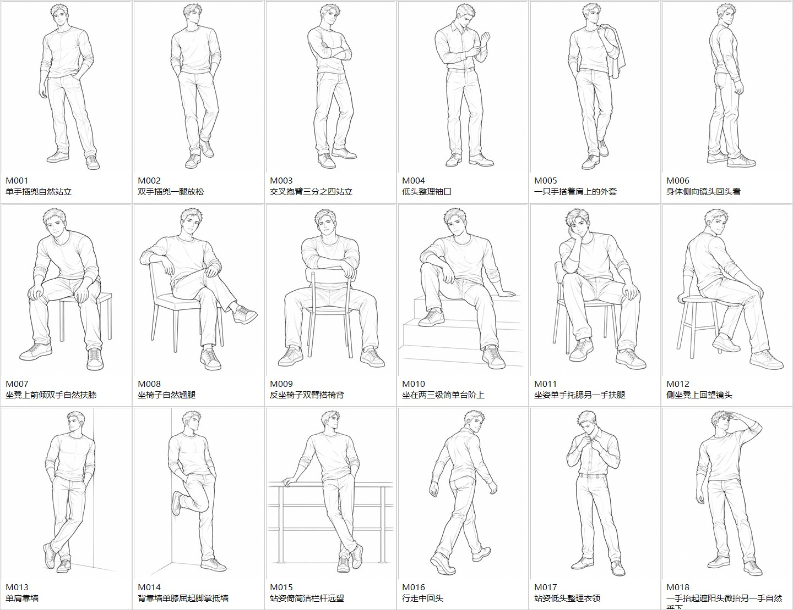
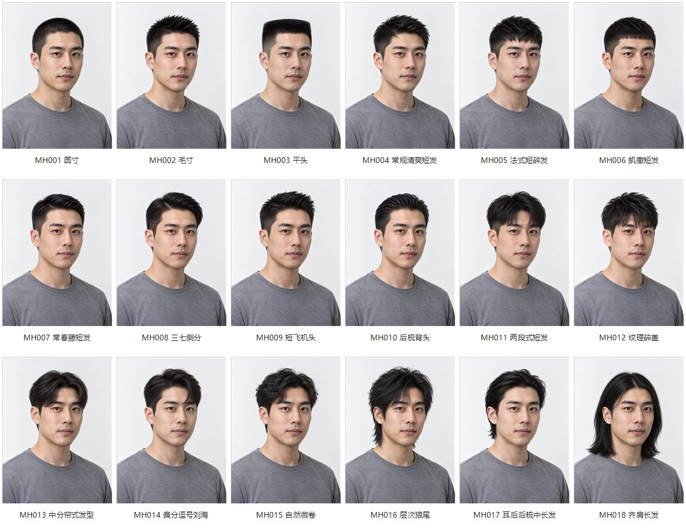
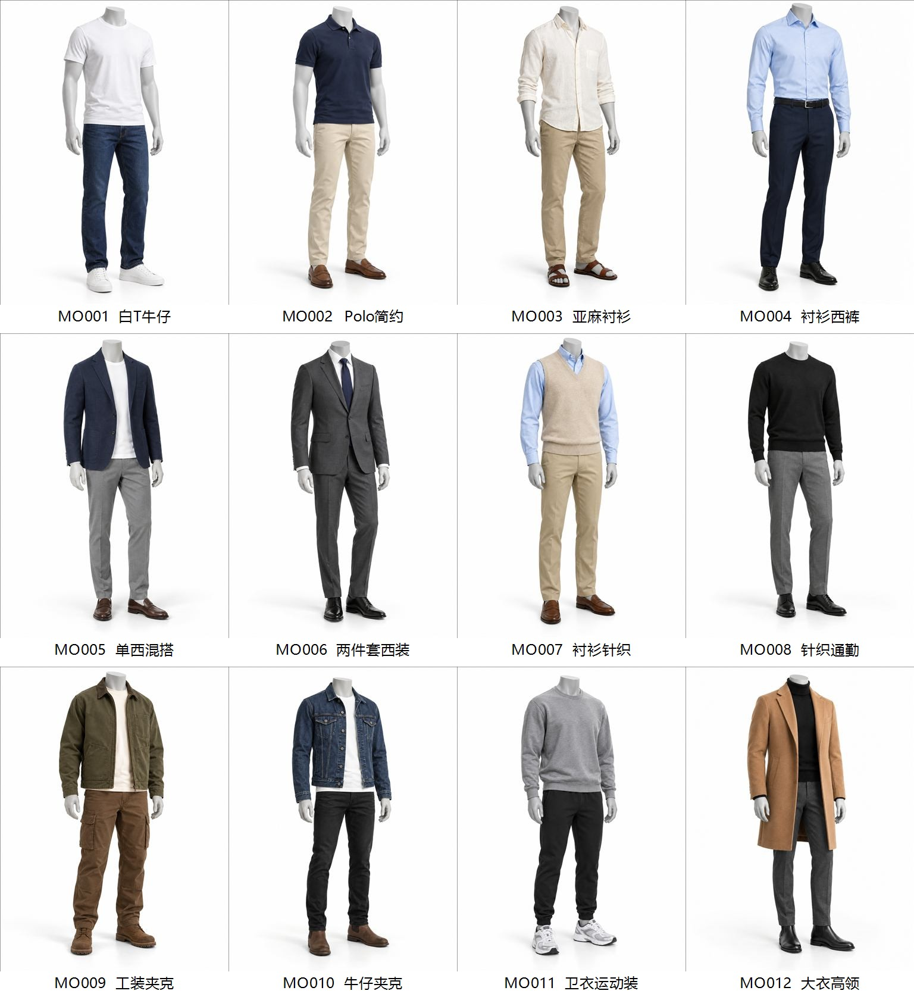

# 男士参考图库（新增素材）

新增 54 张独立 AI 生成图片：18 个男士拍照姿势、3 张男士人物参考、18 款同一人物的发型参考、3 套基础穿搭及 12 套分类穿搭。

- 动作姿势库：选择「男士拍照姿势」，按站姿、坐姿、倚靠或行走筛选。
- 人像库：选择「男士人像」，使用发长和发型筛选。18 款发型主要用于发型对比，并非 18 位不同人物。
- 服装库：选择「男士穿搭」，通过商务、休闲、学院、工装等标签筛选。
- 图片可加入原有合成配方。本地男士图片自动转为 Data URI，避免映射到原作者 CDN 的不存在地址。

## 来源与使用说明

这些新增图片由贡献者使用 Codex 内置图片生成工具制作，为虚构成年男性、服装人台及姿势线稿，不是从原作者网站采集的素材。图片没有真实人物身份或品牌背书。生成提示词随本目录提供；文件路径和 SHA-256 见 `male-gallery-assets.json`。

本说明用于区分新增素材和原作者素材，不修改仓库现有 LICENSE，也不替原作者或平台作额外权利保证。新增 AI 素材的具体使用许可需由贡献者与维护者在合并前确认。

## 总览（仅作预览，资产为独立图片）

